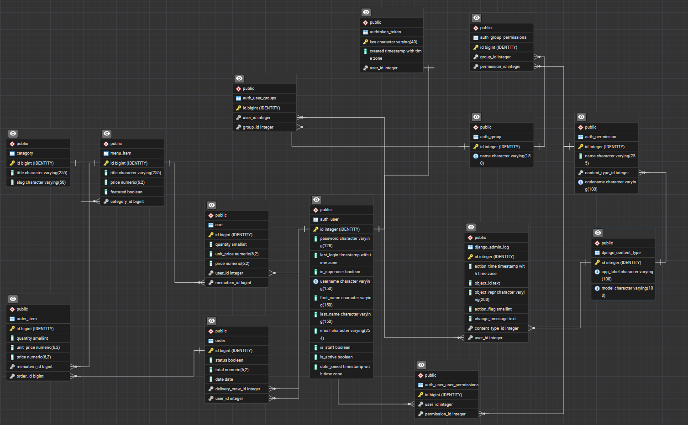

# Little Lemon API

API REST de restaurante creada con Django y Django REST Framework (DRF). Gestiona categorías, platillos, carrito y pedidos, con autenticación por token mediante Djoser y permisos por roles.

## Tecnologías y requisitos

- Python 3.11
- Django 5.2 
- Django REST Framework 3.18
- Djoser 2.3 
- PostgreSQL 17
- Pipenv 
- Git & GitHub

## Instalación

1. Clona el repositorio (reemplaza la URL con la de este proyecto):

   ```bash
   git clone https://github.com/olmos-dev/LittleLemon.git
   ```

2. Instala Pipenv si aún no está disponible:

   ```bash
   pip install pipenv
   ```

3. Crea el entorno virtual e instala dependencias:

   ```bash
   pipenv install
   ```

4. Configura las variables de entorno y PostgreSQL
## PostgreSQL
Crea la base de datos para little lemon

La configuración Django debe utilizar el motor `django.db.backends.postgresql` y el paquete `psycopg`*

## Variables de entorno

Crea `.env` en la raíz, junto a `manage.py`. Está excluido por `.gitignore`. Comparte solo una plantilla `.env.example`, nunca el archivo `.env` real.

| Variable | Descripción |
| --- | --- |
| `SECRET_KEY` | Clave secreta de Django. |
| `DEBUG` | Debe ser `False` en producción. |
| `DB_NAME` | Base de datos PostgreSQL. |
| `DB_USER` | Usuario PostgreSQL. |
| `DB_PASSWORD` | Contraseña PostgreSQL. |
| `DB_HOST` | Servidor PostgreSQL. |
| `DB_PORT` | Puerto PostgreSQL. |
Ejemplo de `.env`:

```env
SECRET_KEY=django-insecure-cambia-esta-clave
DEBUG=True
DB_NAME=littlelemon_db
DB_USER=littlelemon_user
DB_PASSWORD=cambia_esta_contraseña
DB_HOST=127.0.0.1
DB_PORT=5432
```


5. Ejecuta las migraciones:

   ```bash
   pipenv run python manage.py migrate
   ```

6. Crea los usuarios y grupos de muestra:

   ```bash
   pipenv run python manage.py seed
   ```

7. Opcionalmente, carga categorías, platillos y pedidos de muestra:

   ```bash
   pipenv run python manage.py poblar_bd
   ```

   > Este comando elimina y recrea carritos, categorías, platillos, pedidos y líneas de pedido; no modifica usuarios.

8. Inicia el servidor:

   ```bash
   pipenv run python manage.py runserver
   ```

   Disponible en `http://127.0.0.1:8000/`.


## Modelo de datos



- Una **categoría** tiene muchos **platillos**; cada `MenuItem` pertenece a una categoría.
- Un **usuario** tiene muchos registros de **carrito**; cada `Cart` pertenece a un usuario y a un platillo. Un usuario no puede repetir un mismo platillo en su carrito.
- Un **cliente** puede realizar muchos **pedidos**; cada `Order` pertenece a un cliente.
- Un integrante de **Delivery crew** puede recibir muchos pedidos; cada pedido puede estar sin repartidor asignado.
- Un **pedido** tiene muchas líneas `OrderItem`; cada línea corresponde a un platillo. Un platillo solo aparece una vez por pedido.

## Roles y acciones

| Rol | Acciones |
| --- | --- |
| **Manager** | Consulta, crea, edita y elimina categorías y platillos. Ve, asigna repartidor, actualiza y elimina cualquier pedido. Gestiona miembros de Manager y Delivery crew. |
| **Delivery crew** | Ve únicamente sus pedidos asignados y solo puede actualizar su estado de entrega. |
| **Client** | Consulta el menú, agrega/consulta/vacía su carrito, crea pedidos desde el carrito y consulta únicamente sus propios pedidos. |

## Endpoints principales

La raíz de la API es `/api/`.

| Recurso | Endpoint | Acciones |
| --- | --- | --- |
| Autenticación | `/api/auth/` | Registro, inicio de sesión y token con Djoser. |
| Categorías | `/api/categories/` | Lectura autenticada; CRUD para Manager. |
| Platillos | `/api/menu-items` y `/api/menu-items/<id>` | Lectura autenticada; creación, edición y eliminación para Manager. |
| Managers | `/api/groups/manager/users` | Manager lista, agrega o retira usuarios. |
| Delivery crew | `/api/groups/delivery-crew/users` | Manager lista, agrega o retira usuarios. |
| Carrito | `/api/cart/menu-items` | Client consulta, agrega y vacía elementos. |
| Pedidos | `/api/orders` y `/api/orders/<orderId>` | Acciones limitadas por rol. |

Para solicitudes autenticadas envía:

```http
Authorization: Token <tu_token>
```

## Usuarios de prueba

Después de `pipenv run python manage.py seed`, todos usan la contraseña `mypassword123`.

| Usuario | Correo | Nombre | Rol | Staff |
| --- | --- | --- | --- | --- |
| `user1` | user1@mail.com | Emily Carter | Manager | Sí |
| `user2` | user2@mail.com | James Anderson | Delivery crew | No |
| `user3` | user3@mail.com | Olivia Bennett | Delivery crew | No |
| `user4` | user4@mail.com | Daniel Wilson | Delivery crew | No |
| `user5` | user5@mail.com | Sophie Mitchell | Client | No |
| `user6` | user6@mail.com | Henry Thompson | Client | No |

> Las credenciales de muestra son solo efectos de prueba

## Administración

Para crear un superusuario:

```bash
pipenv run python manage.py createsuperuser
```

El panel está en `http://127.0.0.1:8000/admin/`.

